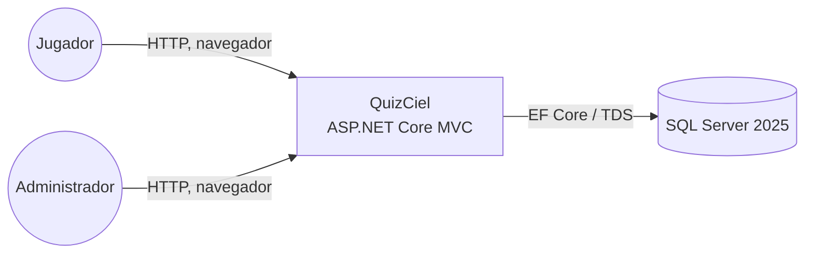
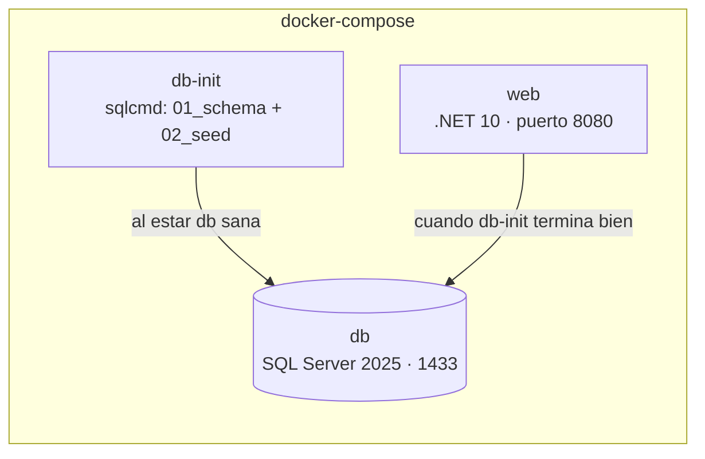
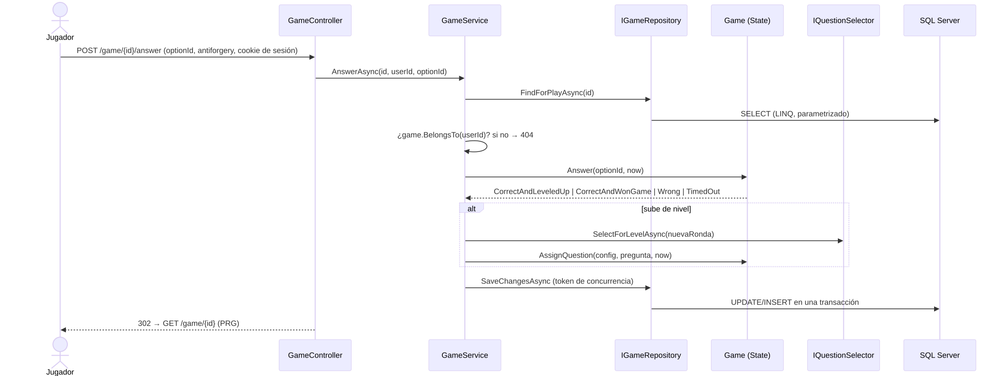
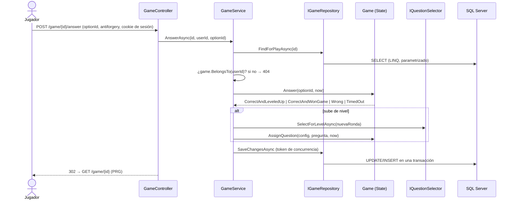

# Arquitectura


## Contexto (C4 nivel 1)



<details>
<summary>Fuente Mermaid del diagrama</summary>



</details>

## Contenedores (C4 nivel 2, docker-compose)



<details>
<summary>Fuente Mermaid del diagrama</summary>



</details>

## Estilo: monolito por capas

Es un solo proyecto web (`src/QuizCiel.Web`) organizado en carpetas con dependencias en una sola dirección:

```
Controllers + Views (MVC)   → presentación, ViewModels, sin reglas de negocio
        ↓
Services                    → casos de uso: cargan, delegan al dominio y guardan
        ↓
Domain                      → entidades, estados y reglas del juego; no depende de EF ni de MVC
        ↑
Data (EF Core)              → DbContext, Fluent API, repositorios, proyecciones de lectura
```

| Carpeta | Contenido |
|---|---|
| `Domain/` | `Game` (raíz de agregado), `GameRound`, `Question`, `AnswerOption`, `Category`, `RoundConfig`, `GameConfiguration`, `Player`, `States/`, `Enums/` (`GameStatus`, `AnswerOutcome`), `GameRules` (constantes de negocio), `Exceptions/` |
| `Services/` | `GameService`, `GameReadinessService`, `CategoryService`, `QuestionService`, `RoundSettingsService`, `Accounts/` (`AccountService`, `AccountSeeder`, `AppRoles`, mensajes de Identity en español), `Strategies/`, `Abstractions/IClock` |
| `Data/` | `QuizDbContext` (hereda de `IdentityDbContext`), `Configurations/`, `Repositories/`, `ReadModels/` |
| `Controllers/` `Views/` `Models/` | MVC, ViewModels y `DisplayFormat` (formato de COP, fechas y estados) |
| `Middleware/` | `ErrorHandlingMiddleware` |
| `wwwroot/css/theme.css` | **Única** fuente de colores (variables CSS); mapea también las variables de Bootstrap |

## Patrones de diseño

| Patrón | Dónde | Qué resuelve |
|---|---|---|
| **State** | `Domain/States`: `InProgressState`, `FinishedState` | `Game` delega `Answer`, `Withdraw` y `ExpireIfTimedOut` a su estado; una partida terminada rechaza todo sin `if` repartidos |
| **Strategy** | `IQuestionSelector` → `RandomQuestionSelector` | Criterio de selección intercambiable; en las pruebas se inyecta un `Random` con semilla |
| **Métodos de fábrica estáticos** | `Game.Start`, `Question.Create`, `Category.Create`, `Player.Create`, `GameConfiguration.Create` | Constructores privados: solo se pueden crear objetos válidos. No es el *Factory Method* de GoF, que usa subclases |
| **MVC** | Controllers / Views / Models | Separa la presentación de la lógica |
| **Service Layer** | `Services/*Service` | Controllers delgados; cada método es un caso de uso |
| **Repository** | `Data/Repositories` | Aísla EF Core; consultas con LINQ (parametrizadas por el ORM) |
| **DTO / ViewModel** | `Models/`, `Data/ReadModels` | El navegador nunca recibe `IsCorrect` mientras se juega |
| **Inyección de dependencias** | `DependencyInjection.cs` | Bajo acoplamiento; `IClock` y `Random` sustituibles en las pruebas |
| **Middleware de errores** | `ErrorHandlingMiddleware` + `UseStatusCodePagesWithReExecute` | Manejo de errores centralizado: 404/409/500 con páginas amigables y registro en el log |

## Identidad y autorización

- **ASP.NET Core Identity** guarda las cuentas en las tablas `AspNet*` de la misma base: contraseñas con hash PBKDF2, bloqueo tras 5 intentos y roles.
- **Roles**: `Player` (se registra solo; usuario = cédula) y `Admin` (lo crea `AccountSeeder` al arrancar con los valores de `AdminCredentials`; si ya existe no se modifica).
- **Dueño de la partida**: `GameService` verifica `game.BelongsTo(userId)` en cada acción. Una partida ajena responde 404, para no revelar que existe. El administrador puede verla, pero no jugarla.
- **Una participación por persona**: la regla vive en `Player.EnsureCanStartGame` y está respaldada por el índice único `Game(PlayerId)`.

## Flujo "Responder pregunta"



<details>
<summary>Fuente Mermaid del diagrama</summary>



</details>

## Seguridad y calidad

- **Respuesta protegida**: `AnswerChoiceViewModel` solo lleva Id y texto; la validación ocurre en el servidor.
- **Tiempo**: el servidor calcula el plazo (`AskedAt + TimeLimit + 2 s de gracia`); el JS solo muestra la cuenta regresiva.
- **Concurrencia optimista**: `Game.ConcurrencyStamp` se renueva en cada guardado; una pestaña desactualizada recibe un mensaje en lugar de sobrescribir.
- **CSRF**: `[ValidateAntiForgeryToken]` en todos los POST.
- **Sesión**: cookie de Identity `HttpOnly` y `SameSite=Strict` que expira a las 2 h con renovación deslizante; `returnUrl` limitado a URLs locales; mensajes de error de login que no revelan si falló el usuario o la contraseña.
- **Datos personales**: la cédula completa solo se muestra en "Premios a pagar"; en el resto de pantallas va enmascarada.
- **SQL**: todas las consultas usan LINQ/EF Core, que parametriza los valores. No hay SQL concatenado.
- **Errores**: el middleware registra con Serilog y las páginas 404/409/500 son amigables.
- **Logs de negocio** (Serilog, estructurados): registro de jugadores, partida iniciada, cada respuesta con su resultado y premio, retiro, fin por tiempo, intentos de ingreso (exitosos, fallidos y bloqueos) y reglas de negocio rechazadas. Se identifican por Id de jugador, de cuenta o de partida; la cédula nunca se registra completa y las contraseñas nunca se registran.
- **Defensa en profundidad**: la BD repite las invariantes que se pueden expresar por fila o índice (CHECK, UNIQUE, índice filtrado de respuesta correcta).
