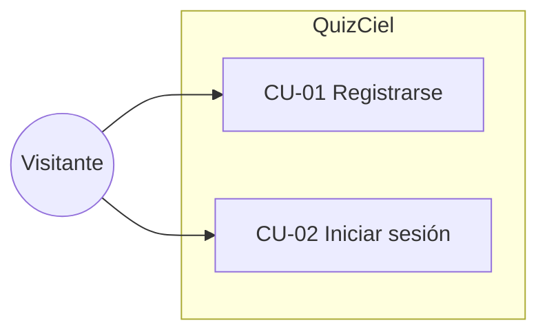
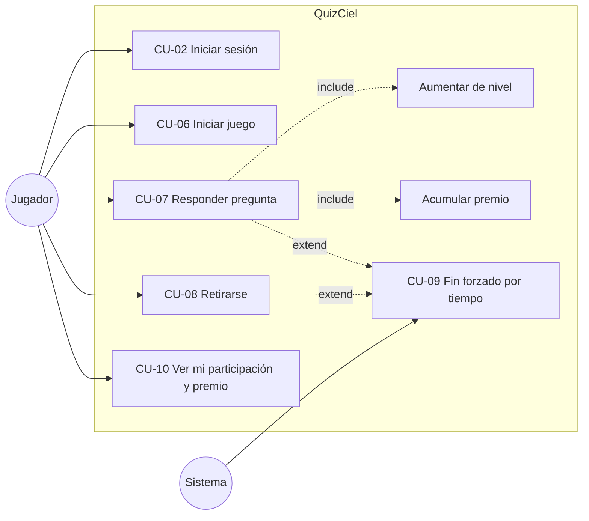
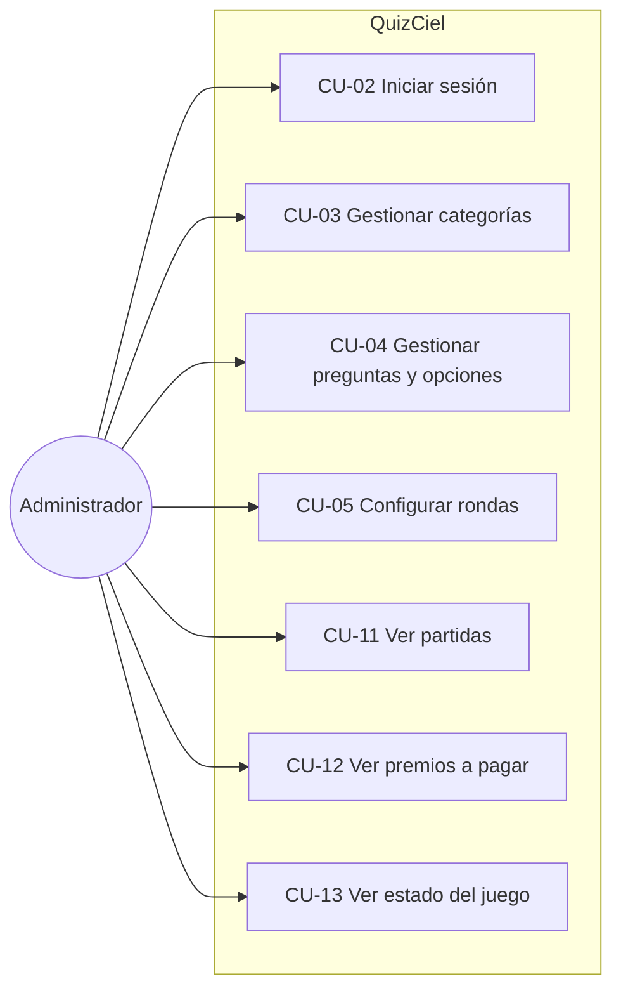

# Casos de uso

## Actores

| Actor | Descripción |
|---|---|
| **Visitante** | Persona sin sesión. Puede consultar las reglas y los premios, registrarse o iniciar sesión. |
| **Jugador** | Persona registrada con **cédula** y contraseña. Solo puede participar una vez. |
| **Administrador** | Configura el juego y consulta las partidas y los premios. Su cuenta se crea al iniciar la aplicación. |
| **Sistema** | Aplica reglas automáticas, como terminar una partida cuando se acaba el tiempo. |

## Supuestos

El enunciado deja algunos puntos abiertos. Estas son las interpretaciones adoptadas:

| Punto abierto | Interpretación |
|---|---|
| Quién juega y a quién se le paga | Cada jugador se registra con su **cédula**, que lo identifica aunque dos personas tengan el mismo nombre. |
| Cuántas veces se puede jugar | **Una partida por persona**, sin importar el resultado, para que el premio sea justo y no se pueda repetir hasta ganar. Para probar de nuevo hay que registrar otra cédula. |
| Qué es el "fin del juego forzado" | Que se acabe el **tiempo de la ronda** sin responder. Se trata como no responder: la partida termina **sin premio**, igual que una respuesta incorrecta. Para llevarse el acumulado, el jugador debe retirarse antes. |
| Premio | Dinero en **pesos colombianos (COP)**, configurable por ronda y estrictamente creciente. |
| Categorías | Una categoría por nivel (1 a 5); la ronda N usa la categoría de nivel N. |

## Diagramas

Hay un diagrama por actor. El **Sistema** aparece en el diagrama del jugador porque CU-09 se relaciona con los casos de la partida.

### Visitante

Fuente Mermaid del diagrama

### Jugador

Fuente Mermaid del diagrama

### Administrador

Fuente Mermaid del diagrama

## Fichas

### CU-01 Registrarse (Visitante)
- **Flujo principal**: la persona escribe su cédula, nombre, contraseña y confirmación → el sistema limpia la cédula (quita puntos, guiones y espacios) y el nombre → crea la cuenta de Identity y el registro `Player` en **una sola transacción** → inicia sesión.
- **Reglas**: la cédula tiene entre 6 y 10 dígitos y es **única**. El nombre tiene entre 3 y 80 caracteres, y solo admite letras (con tildes), espacios, apóstrofos y guiones. La contraseña debe tener al menos 8 caracteres, una mayúscula, una minúscula y un número.
- **Alternos**: A1, cédula ya registrada → "Ya existe una cuenta con esa cédula". A2, contraseña débil → se muestra un mensaje y no se crea la cuenta.

### CU-02 Iniciar sesión (Jugador o Administrador)
- **Flujo principal**: la persona escribe su cédula (jugador) o usuario (administrador) y contraseña → Identity verifica los datos → se crea la sesión con el rol correspondiente.
- **Alternos**: A1, datos incorrectos → "Cédula, usuario o contraseña incorrectos" (no se indica cuál falló). A2, 5 intentos fallidos → la cuenta se bloquea durante 5 minutos.

### CU-03 Gestionar categorías (Administrador)
- **Flujo principal**: el administrador crea o edita una categoría (nombre, nivel 1–5 y descripción).
- **Reglas**: solo puede haber una categoría por nivel. El nivel N corresponde a la ronda N. Una categoría solo se puede eliminar si no tiene preguntas.

### CU-04 Gestionar preguntas y opciones (Administrador)
- **Flujo principal**: el administrador crea o edita una pregunta con 4 opciones y 1 respuesta correcta. También puede activarla o desactivarla.
- **Reglas**: las 4 opciones deben ser diferentes y no estar vacías. Una pregunta **ya jugada** no se puede editar. Cada categoría debe tener al menos **5 preguntas activas**.

### CU-05 Configurar rondas (Administrador)
- **Flujo principal**: el administrador edita el premio (COP) y el tiempo de las 5 rondas en un solo formulario → el sistema valida los datos → guarda los cambios.
- **Reglas**: deben existir las 5 rondas. El premio debe ser entero, mayor que 0 y **estrictamente creciente**. El tiempo debe estar entre 10 y 120 segundos.
- **Alternos**: A1, un premio es igual o menor que el anterior → se muestra un error y no se guarda nada.

### CU-06 Iniciar juego (Jugador)
- **Precondición**: el jugador tiene sesión iniciada y el juego está configurado (CU-13 en verde).
- **Flujo principal**: el jugador pulsa "Empezar mi partida" → el sistema verifica que **no haya participado antes** → elige una pregunta activa del nivel 1 → crea la partida en la ronda 1 con premio acumulado de 0.
- **Alternos**: A1, ya participó (sin importar el resultado) → "Ya participaste en el concurso". A2, juego sin configurar → se muestra un mensaje.
- **Respaldo en la BD**: el índice único `Game(PlayerId)` evita que dos clics al mismo tiempo creen dos partidas; el segundo clic recibe el mismo mensaje de A1.

### CU-07 Responder pregunta (incluye *Aumentar de nivel* y *Acumular premio*)
- **Precondición**: el jugador tiene una partida propia en curso y una pregunta sin responder.
- **Flujo principal**: el jugador elige una opción → el sistema revisa el tiempo y valida la respuesta en el servidor → si es correcta, **acumula** el premio, **sube de nivel** y asigna una pregunta del siguiente nivel.
- **Alternos**: A1, respuesta incorrecta → `Perdió`, premio 0. A2, acierto en la ronda 5 → `Ganó`. A3, tiempo agotado → CU-09. A4, partida de otra persona → 404. A5, partida actualizada desde otra pestaña → se muestra un mensaje.

### CU-08 Retirarse (Jugador)
- **Precondición**: el jugador tiene una partida propia en curso y la pregunta actual **sin responder**.
- **Flujo principal**: el jugador confirma que quiere retirarse → la partida termina en `Se retiró` y conserva el premio acumulado.

### CU-09 Fin forzado por tiempo (Sistema)
- **Disparador**: se realiza una acción o consulta después del plazo (tiempo de la ronda + 2 segundos de gracia). Las partidas abandonadas (el jugador cerró el navegador) se cierran cuando el administrador abre la lista de partidas (CU-11).
- **Resultado**: la partida termina en `Tiempo agotado` y el premio queda en 0. El navegador solo muestra el temporizador; el servidor toma la decisión.

### CU-10 Ver mi participación y premio (Jugador)
- En la página de inicio, el jugador ve su nombre, la cédula enmascarada y una de estas opciones: "Empezar mi partida", "Continuar mi partida" o **el premio que le corresponde**, junto con el resultado y el enlace al detalle.

### CU-11 Ver partidas (Administrador)
- Muestra las 100 partidas más recientes con jugador, cédula enmascarada, estado, ronda y premio. Permite filtrar por nombre o cédula. Cada fila abre el detalle.

### CU-12 Ver premios a pagar (Administrador)
- Muestra las partidas terminadas con premio mayor que $0 (ganadas o retiradas con premio acumulado). Incluye **nombre y cédula completa**, fecha, valor y **total**. Es una consulta; el registro de pagos no está incluido.

### CU-13 Ver estado del juego (Administrador)
- Muestra cuántas preguntas activas hay en cada nivel y si la configuración de rondas es válida. Si hay algún problema, nadie puede iniciar una partida.
