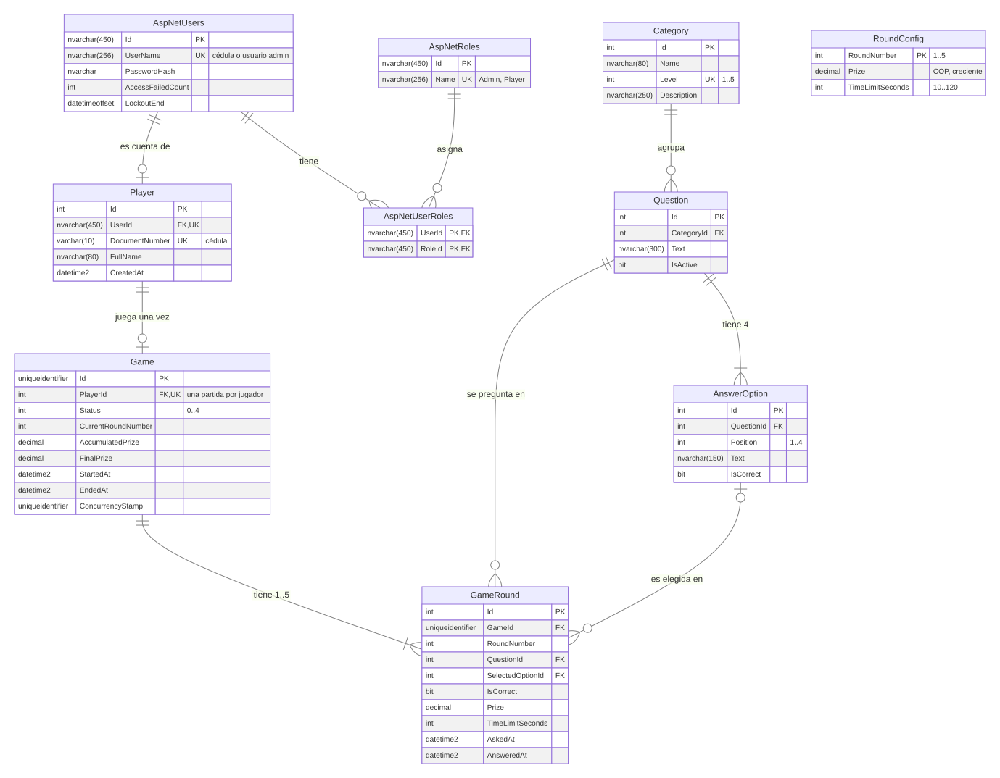
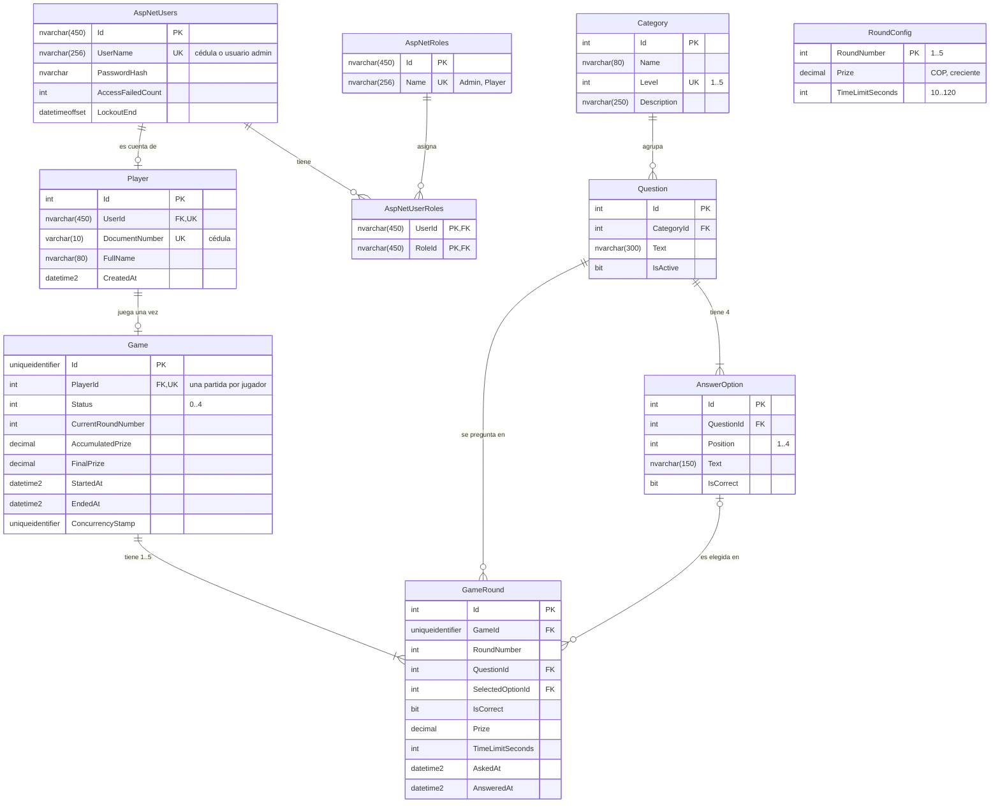

# Modelo entidad-relación

Fuente Mermaid del diagrama

`RoundConfig` no tiene llave foránea: la ronda N se relaciona con la categoría por la regla **nivel = número de ronda**.

Las tablas `AspNet*` son el esquema estándar de **ASP.NET Core Identity**. Además de las del diagrama están `AspNetUserClaims`, `AspNetRoleClaims`, `AspNetUserLogins` y `AspNetUserTokens`, que se crean en el script pero no se usan. El administrador es una cuenta con rol `Admin` sin registro `Player`.

## Diccionario de datos

### Category
| Columna | Tipo | Restricción | Descripción |
|---|---|---|---|
| Id | INT IDENTITY | PK | |
| Name | NVARCHAR(80) | NOT NULL | Nombre visible |
| Level | INT | UNIQUE, CHECK 1–5 | Nivel de complejidad; alimenta la ronda del mismo número |
| Description | NVARCHAR(250) | NULL | |

### Question
| Columna | Tipo | Restricción | Descripción |
|---|---|---|---|
| Id | INT IDENTITY | PK | |
| CategoryId | INT | FK → Category | |
| Text | NVARCHAR(300) | NOT NULL | Enunciado |
| IsActive | BIT | NOT NULL | Solo las activas se sortean |

### AnswerOption
| Columna | Tipo | Restricción | Descripción |
|---|---|---|---|
| Id | INT IDENTITY | PK | |
| QuestionId | INT | FK → Question (cascade) | |
| Position | INT | CHECK 1–4, UNIQUE (QuestionId, Position) | Orden de presentación (A–D) |
| Text | NVARCHAR(150) | NOT NULL | |
| IsCorrect | BIT | Índice único filtrado `WHERE IsCorrect = 1` | Garantiza una sola correcta por pregunta |

### RoundConfig
| Columna | Tipo | Restricción | Descripción |
|---|---|---|---|
| RoundNumber | INT | PK, CHECK 1–5 | |
| Prize | DECIMAL(18,0) | CHECK > 0 | Premio en pesos. "Mayor que la ronda anterior" se valida en el dominio |
| TimeLimitSeconds | INT | CHECK 10–120 | |

### AspNetUsers (Identity)
| Columna | Tipo | Restricción | Descripción |
|---|---|---|---|
| Id | NVARCHAR(450) | PK | GUID en texto |
| UserName / NormalizedUserName | NVARCHAR(256) | UNIQUE (normalizado) | Cédula del jugador o usuario del administrador |
| PasswordHash | NVARCHAR(MAX) | | Hash PBKDF2 de Identity; la contraseña nunca se guarda en claro |
| AccessFailedCount / LockoutEnd | INT / DATETIMEOFFSET | | Bloqueo de 5 minutos tras 5 intentos fallidos |

### Player
| Columna | Tipo | Restricción | Descripción |
|---|---|---|---|
| Id | INT IDENTITY | PK | |
| UserId | NVARCHAR(450) | FK → AspNetUsers, UNIQUE | Cuenta con la que ingresa |
| DocumentNumber | VARCHAR(10) | UNIQUE, CHECK 6–10 dígitos | Cédula: identifica a quién se le paga, aunque dos personas tengan el mismo nombre |
| FullName | NVARCHAR(80) | NOT NULL | Nombre completo normalizado |
| CreatedAt | DATETIME2 | NOT NULL | UTC |

### Game
| Columna | Tipo | Restricción | Descripción |
|---|---|---|---|
| Id | UNIQUEIDENTIFIER | PK | GUID no adivinable, usado en la URL |
| PlayerId | INT | FK → Player, **UNIQUE** | Cada persona participa una sola vez |
| Status | INT | CHECK 0–4 | 0 En curso, 1 Ganó, 2 Se retiró, 3 Perdió, 4 Tiempo agotado |
| CurrentRoundNumber | INT | CHECK 1–5 | |
| AccumulatedPrize | DECIMAL(18,0) | CHECK ≥ 0 | |
| FinalPrize | DECIMAL(18,0) | NULL mientras está en curso | Lo que se lleva el jugador |
| StartedAt / EndedAt | DATETIME2 | CHECK coherente con Status | UTC |
| ConcurrencyStamp | UNIQUEIDENTIFIER | Token de concurrencia | Evita doble respuesta o dos pestañas |

### GameRound
| Columna | Tipo | Restricción | Descripción |
|---|---|---|---|
| Id | INT IDENTITY | PK | |
| GameId | UNIQUEIDENTIFIER | FK → Game (cascade), UNIQUE (GameId, RoundNumber) | Una pregunta por ronda |
| RoundNumber | INT | CHECK 1–5 | |
| QuestionId | INT | FK → Question | |
| SelectedOptionId | INT | FK → AnswerOption, NULL | NULL hasta responder |
| IsCorrect | BIT | NULL | |
| Prize / TimeLimitSeconds | DECIMAL(18,0) / INT | NOT NULL | **Copia** de la configuración al momento de preguntar |
| AskedAt / AnsweredAt | DATETIME2 | AskedAt NOT NULL; AnsweredAt NULL hasta responder | UTC; con AskedAt + TimeLimit se calcula el plazo |
